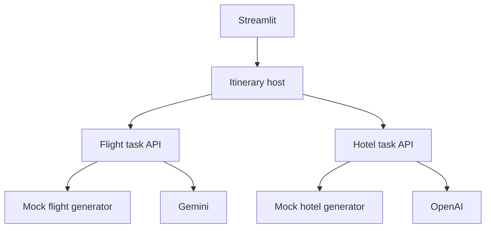

# Multi-Agent Travel Planner

**Explore how a host agent coordinates specialized services to answer one travel request.**

A Python demonstration with a Streamlit interface, a travel-planning host, flight and hotel agents, and mock travel-data generators. The agents expose task and discovery endpoints through a shared FastAPI implementation.

## Why this project exists

An application becomes easier to understand when orchestration, specialized reasoning, and tool data are separate. This project explores those boundaries through a familiar request: combine flight and hotel suggestions into an itinerary.

## What is included

- A Streamlit interface for entering a trip request.
- A host agent that coordinates the flight and hotel services.
- Gemini-based request processing and OpenAI-backed hotel reasoning.
- Agent cards, task requests, and health endpoints.
- Mock flight and hotel generators in the MCP-server modules.

Travel results are simulated. The current agent implementations can call the mock generators directly; the presence of MCP modules does not mean every tool call uses a separate MCP connection. The shared A2A-style implementation should be checked against the protocol version required by any external client.

## Run locally

From the repository root, use Python and create an isolated environment:

```bash
python -m venv .venv
source .venv/bin/activate
pip install -r requirements.txt
```

Configure your own `GOOGLE_API_KEY` and `OPENAI_API_KEY` locally. Model availability and usage depend on the provider accounts. Activate the same environment in three terminals for the flight service, hotel service, and Streamlit UI. Run these commands from the repository root:

| Process | Command | Default port |
|---|---|---|
| Flight agent | `python -m flight_search_app.flight_server` | 8000 |
| Hotel agent | `python -m hotel_search_app.hotel_server` | 8003 |
| Interface | `streamlit run itinerary_planner/streamlit_ui.py` | 8501 |

Open `http://localhost:8501`. Streamlit invokes the itinerary host directly in its own process. To expose that host to an external HTTP client as well, optionally run `python -m itinerary_planner.itinerary_server` on port 8005 in a fourth terminal. The modules are at the repository root; an additional `Agent2/` directory is not required.

## Example

Ask for a week-long trip from San Francisco to Tokyo and provide your dates. The host gathers the request details, asks the specialized services for suggestions, and synthesizes an itinerary. Treat prices and availability as generated demonstration data.

## Architecture



| Directory | Responsibility |
|---|---|
| [`common/`](common) | Shared task types, HTTP client, and FastAPI server |
| [`itinerary_planner/`](itinerary_planner) | Host orchestration and UI |
| [`flight_search_app/`](flight_search_app) | Flight agent and server |
| [`hotel_search_app/`](hotel_search_app) | Hotel agent and server |
| [`mcp_servers/`](mcp_servers) | Tool definitions and mock travel data |

## Reference and license

The original project references [this multi-agent travel-planning walkthrough](https://medium.com/ai-cloud-lab/building-multi-agent-ai-app-with-googles-a2a-agent2agent-protocol-adk-and-mcp-a-deep-a94de2237200). Its original README declares the MIT License; the current tree does not contain a separate license file.
